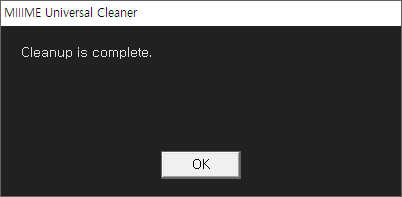

# MIIIME Universal Cleaner (MUC™)

MIIIMECleaner · 미메클리너


[](https://www.autoitscript.com/site/)


<br>

<br>

Cleans up unnecessary files and folders according to rules defined in the INI configuration file.   
Supports both 'Delete' mode and 'Exclude' mode.
It can also remove shared registry values and execution traces (SharedClean / TraceClean).
Can also work as a companion tool for MIIIMETools.

INI 설정 파일에 정의된 규칙에 따라 불필요한 파일과 폴더를 정리합니다.  
'삭제(Delete)' 모드와 '남기기(Exclude)' 모드를 지원하며, 공용 레지스트리 값과 실행 흔적도 정리할 수 있습니다 (SharedClean / TraceClean).  
미메툴즈의 보조 도구로 사용할 수 있습니다.

<br>

<br>

---

### File Organization

```text
MIIIMEUniCleaner.exe     # [Run] Cleaner executable file / 클리너 실행 파일
MIIIMEUniCleaner.ini     # [Settings] Cleanup target and rules / 정리 대상 및 규칙
```

---

## How to Use

The four sections `[CleanupExclude]` / `[CleanupDelete]` / `[SharedClean]` / `[TraceClean]` run in this order.  
Each section has its own `LinkedMode` setting that chooses which INI it is read from.

**[사용 방법]**

`[CleanupExclude]` / `[CleanupDelete]` / `[SharedClean]` / `[TraceClean]` 4개 섹션이 이 순서로 실행됩니다.  
각 섹션의 `LinkedMode` 설정으로 그 섹션을 어느 INI 에서 읽을지 선택합니다.

### Standalone Mode

1. Open [MIIIMEUniCleaner.ini], set `LinkedMode=0` in the section you want to use,
   and add the entries to that section.
2. Run [MIIIMEUniCleaner.exe].

**[독립 모드]**

1. [MIIIMEUniCleaner.ini]를 열어 사용할 섹션의 `LinkedMode` 를 0 으로 두고,
   그 섹션에 정리 대상을 추가.
2. [MIIIMEUniCleaner.exe]를 실행.

### Linked Mode

- `LinkedMode=1` reads that section from the linked INI (e.g. a launcher INI) found
by LinkedIniName in the same path as MIIIMEUniCleaner.exe.  
Do not write entries in the section of MIIIMEUniCleaner.ini when `LinkedMode=1` (they are ignored).

- The linked INI is searched only when at least one section has `LinkedMode=1`.
A section without `LinkedMode` is treated as 0.

- If no section has `LinkedMode` at all, the earlier rule applies: when [CleanupExclude] / [CleanupDelete]
of MIIIMEUniCleaner.ini have entries, all sections are read from it; otherwise from the linked INI.

- LinkedIniName ([Options]) is a priority list separated by pipes (`|`). e.g. `|*_x64_M|*_M|*_x86_M|`  
Entries are searched in order, and the first entry that finds an .ini file is used.  
An error occurs if one entry finds two or more files, or if no entry finds a file.

**[연동 모드]**

- `LinkedMode=1` 이면 그 섹션을 MIIIMEUniCleaner.exe 와 동일한 경로에서 LinkedIniName 으로 찾은
연동 INI(런처 INI 등)에서 읽습니다.  
`LinkedMode=1` 인 섹션에는 MIIIMEUniCleaner.ini 쪽에 항목을 적지 않습니다 (적어도 무시됩니다).

- 연동 INI 는 `LinkedMode=1` 인 섹션이 하나라도 있을 때만 찾습니다.
`LinkedMode` 가 없는 섹션은 0 으로 처리됩니다.

- 어느 섹션에도 `LinkedMode` 가 없으면 이전 방식을 따릅니다: MIIIMEUniCleaner.ini 의 [CleanupExclude] / [CleanupDelete] 에
항목이 있으면 모든 섹션을 이 파일에서, 없으면 연동 INI 에서 읽습니다.

- LinkedIniName([Options])은 파이프(`|`)로 구분된 우선순위 목록입니다. 예: `|*_x64_M|*_M|*_x86_M|`  
앞에서부터 차례로 탐색하여 .ini 파일이 발견된 첫 항목을 사용합니다.  
한 항목에서 2개 이상 발견되거나 어느 항목에서도 발견되지 않으면 에러가 발생합니다.

### Setting tips

- [CleanupExclude] : Keeps only the listed items, deletes the rest.    

- [CleanupDelete] : Deletes the listed items.

- [SharedClean] : Deletes only registry values whose NAME matches (HKCU shared areas such as OpenWithProgids).

- [TraceClean] : Deletes execution-trace values (MuiCache / UserAssist) of the listed programs.

- [SharedClean] / [TraceClean] are skipped (WARN) while a launcher that reads the linked INI (x64 / x86 / _M) or the target exe is running.

- [SharedClean] logs one WARN line if a snapshot folder left by a launcher crash (MIIIMESnap_*) exists. It is not deleted.

- With a linked INI, the macros {Usr} / {CommonFiles} / {_MIIIMEEnv} / {AppName} are also available.

- [SharedClean] has no host-value protection: write specific names (e.g. `WinMount.7z` rather than `WinMount.~`).

- Safety : Drive roots, Documents, Desktop, Windows, Program Files, etc. are blocked by default.

**[설정 팁]**

- [CleanupExclude] : 목록의 항목만 남기고 나머지를 삭제.    

- [CleanupDelete] : 목록의 항목을 삭제.  

- [SharedClean] : 공용 레지스트리 영역(OpenWithProgids 등, HKCU)에서 이름이 일치하는 값만 삭제.

- [TraceClean] : 지정한 프로그램의 실행 흔적(MuiCache / UserAssist) 값을 삭제.

- 연동 INI 를 읽는 런처(x64 / x86 / _M) 또는 타겟 exe 가 실행 중이면 [SharedClean] / [TraceClean] 은 건너뜁니다 (WARN).

- 런처가 크래시로 남긴 스냅샷 폴더(MIIIMESnap_*)가 있으면 [SharedClean] 이 WARN 한 줄을 남깁니다. 폴더는 지우지 않습니다.

- 연동 INI 가 있으면 {Usr} / {CommonFiles} / {_MIIIMEEnv} / {AppName} 매크로도 사용할 수 있습니다.

- [SharedClean] 은 호스트 값 보호가 없습니다: 이름을 구체적으로 적으십시오 (예: `WinMount.~` 보다 `WinMount.7z`).

- 안전장치 : 드라이브 루트, 문서, 바탕화면, Windows, Program Files 등은 기본적으로 삭제가 차단됩니다.

---

## 🛡️ Security & Anti-virus Info

### [✅ VirusTotal Analysis Report](https://www.virustotal.com/gui/file/eb786d98123746c36c3b8ac4b85faab95bdeee1f6a7c2c5d2a3908e69b551d1f?nocache=1)

| Status             | Details                                                                        |
|:------------------ |:------------------------------------------------------------------------------ |
| **Major Vendors**  | **Clean** (Passed by AhnLab V3, Kaspersky, Microsoft, Avast, ESET, etc.)       |
| **Detection Rate** | **8 / 71** (Mostly Heuristic/Generic/Trojan-type flags)                        |
| **Integrity**      | Private project; verified via hashes and VT results. 						  |

> This Program was created with AutoIt. Some antivirus programs may incorrectly detect it as a virus.  
> 본 프로그램은 AutoIt으로 제작되었습니다. 일부 백신이 바이러스로 오진 할 수 있습니다. 

**File Checksum (SHA-256) :** `eb786d98123746c36c3b8ac4b85faab95bdeee1f6a7c2c5d2a3908e69b551d1f`

---

## Disclaimer

Provided **“AS IS”**, without warranty.  
This is a **private project**. No technical support is provided.

본 프로그램은 **“있는 그대로”** 제공되며, 사용 중 발생하는 문제에 대해 제작자는 책임을 지지 않습니다.  
기술 지원은 제공되지 않습니다.

---

## Project Information

**Developer** : MIIIME  
**Website** : https://www.miiime.com  
**GitHub** : [@miiimeworks](https://github.com/miiimeworks)  
**Last Update** : 2026-11-04   

<br>
  
<br>
<br>
<br>